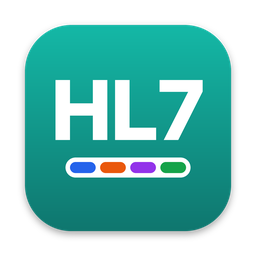

# macOS app

HL7 Decoder also runs as a native macOS app, built with [React Native for macOS](https://microsoft.github.io/react-native-macos/) (`react-native-macos`). It uses the same decoding engine (`src/hl7`) and the same screen and components (`src/Decoder.tsx`, `src/ui`) as the iOS, Android and web app, so a fix in either place reaches every platform.

The macOS host lives in [`macos-app/`](../macos-app). It is a separate npm project with its own `node_modules`, because `react-native-macos` follows React Native one minor version at a time and its newest release (0.83) is older than the React Native the Expo app uses (0.86, from Expo SDK 57). Keeping it separate means the Expo targets keep their versions and the macOS app gets the versions it needs.

## Requirements

| Tool | Version | Notes |
| --- | --- | --- |
| macOS | 14 or later | The deployment target is macOS 14.0. Built and tested on macOS 26.5 with Xcode 26.6. |
| Xcode | 26 or later, from the App Store | The full app, not just the Command Line Tools. Open it once to accept the licence, then run `sudo xcode-select -s /Applications/Xcode.app` (or `export DEVELOPER_DIR=/Applications/Xcode.app/Contents/Developer` in the shell you build from). |
| Node.js | 20 or later | |
| CocoaPods | 1.15 or later | `brew install cocoapods`. Set `export LANG=en_US.UTF-8` in your shell profile or `pod install` fails with an encoding error. |

## Building and running

```bash
cd macos-app
npm install                 # React Native 0.83 + react-native-macos 0.83
npm run pods                # pod install for macos/HL7DecoderMac.xcworkspace
npm run macos               # builds the Debug app, starts Metro and launches it
```

`npm run macos` opens Metro in a new Terminal window; leave it running while you work, and edits to `src/` reload in the app. To work in Xcode instead, run `npm start` in `macos-app`, open `macos-app/macos/HL7DecoderMac.xcworkspace` (the workspace, not the `.xcodeproj`), pick the **HL7DecoderMac-macOS** scheme and press Run.

### A release build

```bash
cd macos-app
npm run build               # react-native build-macos --mode Release
```

Release builds bundle the JavaScript into the app (`main.jsbundle`), so they run without Metro. The app ends up in Xcode's DerivedData folder under `Build/Products/Release/HL7DecoderMac.app`. To build to a known folder instead:

```bash
cd macos-app/macos
xcodebuild -workspace HL7DecoderMac.xcworkspace -scheme HL7DecoderMac-macOS \
  -configuration Release -derivedDataPath build -destination 'platform=macOS' build
open build/Build/Products/Release/HL7DecoderMac.app
```

In Xcode, use **Product › Archive** to export a signed copy. Signing is left at Xcode's "Sign to Run Locally" default. To share the app with other Macs, set your team under **Signing & Capabilities** and notarise the archive.

To check that the JavaScript bundles for macOS without building the native app (this needs no Xcode):

```bash
cd macos-app
npm run bundle              # writes build/main.jsbundle
```

## How it fits together

| Path | What it is |
| --- | --- |
| `macos-app/index.js` | Entry point. Registers `Decoder` from `../src/Decoder.tsx` as the root component. |
| `macos-app/metro.config.js` | Watches the repository root so `../src` is bundled, and resolves every package from `macos-app/node_modules` only, so the shared code never picks up the Expo app's React Native 0.86. |
| `macos-app/macos/HL7DecoderMac-macOS/AppDelegate.swift` | SwiftUI app with one window that hosts the React Native view. |
| `macos-app/macos/HL7DecoderMac-macOS/Assets.xcassets/AppIcon.appiconset` | The app icon at every macOS size, drawn by `tools/make_icon.py` (see [App icon](#app-icon)). |
| `macos-app/macos/HL7DecoderMac-macOS/HL7MacBridge.m` | Native module for the clipboard (`NSPasteboard`) and the Open panel (`NSOpenPanel`). Files are read off the main thread; UTF-8, UTF-16 and UTF-32 with a byte-order mark, plain UTF-8 and Latin-1 are all read correctly. |
| `macos-app/macos/HL7DecoderMac-macOS/HL7DecoderMac.entitlements` | Debug entitlements: App Sandbox, read access to files the user picks, and network access to reach Metro. |
| `macos-app/macos/HL7DecoderMac-macOS/HL7DecoderMac-Release.entitlements` | Release entitlements: the same without network access, since the JavaScript is bundled and the app never goes online. |
| `src/platform/index.tsx` | Clipboard, file picking and the screen wrapper for the Expo targets (expo-clipboard, expo-document-picker, expo-file-system, safe-area-context). |
| `src/platform/index.macos.tsx` | The same functions for macOS, calling `HL7MacBridge`. Metro picks this file when bundling for the `macos` platform. |

Expo modules are not used on macOS. Their macOS support is experimental and tied to Expo SDK versions that match React Native 0.83, so the three things the screen needs from the platform (read the clipboard, write the clipboard, open files) go through the small native module instead.

`src/ui/theme.ts` uses Menlo for monospaced text on macOS as on iOS.

## App icon



The icon is "HL7" in white on the app's teal, over a strip in the four colours the app uses for HL7 delimiters (`|` blue, `^` orange, `~` purple, `&` green). It follows Apple's macOS icon grid: an 824-pixel rounded square with a soft shadow on a 1024-pixel canvas.

The PNGs are generated, so change the design in `tools/make_icon.py` rather than editing them:

```bash
python3 -m pip install pillow
python3 tools/make_icon.py                     # uses Inter Display ExtraBold from /usr/share/fonts
python3 tools/make_icon.py ~/Library/Fonts/InterDisplay-ExtraBold.otf   # or point it at a copy of the font
```

It writes all ten sizes (16 to 512 points, at 1x and 2x) into the icon set and updates its `Contents.json`. Inter is free under the SIL Open Font Licence from [rsms.me/inter](https://rsms.me/inter). Rebuild the app afterwards; macOS caches icons, so if the Dock still shows the old one, run `killall Dock`.

## Keeping the targets in step

- Shared code in `src/` must only use React Native APIs that exist in both 0.83 and 0.86. Typecheck and tests at the root (`npm run typecheck`, `npm test`) cover the shared code; `npm run bundle` in `macos-app` catches anything Metro cannot resolve for macOS.
- Anything platform-specific goes in `src/platform/`, with an `index.macos.tsx` counterpart.
- When `react-native-macos` releases a version matching the Expo app's React Native, the host can move to it by bumping `react-native`, `react-native-macos` and the `@react-native/*` packages in `macos-app/package.json` together, then running `npm install` and `npm run pods`.

## Known gaps

- The placeholder text in **Go to path** does not show on macOS. The box still works: click it, type a path and press Return.

## Troubleshooting

| Symptom | Fix |
| --- | --- |
| `xcodebuild requires Xcode, but active developer directory ... is a command line tools instance` | Install Xcode and run `sudo xcode-select -s /Applications/Xcode.app`. |
| `pod install` fails with `Unicode Normalization not appropriate for ASCII-8BIT` | `export LANG=en_US.UTF-8` and run it again. |
| The app opens with a red "No bundle URL present" screen | Metro isn't running. Run `npm start` in `macos-app`. |
| `HL7MacBridge native module is missing` | The native app is older than the JavaScript. Rebuild it from Xcode or with `npm run macos`. |
| Metro reports two copies of React, or `react-native` 0.86 | Run Metro from `macos-app`, not the repository root, so `metro.config.js` there is used. |
