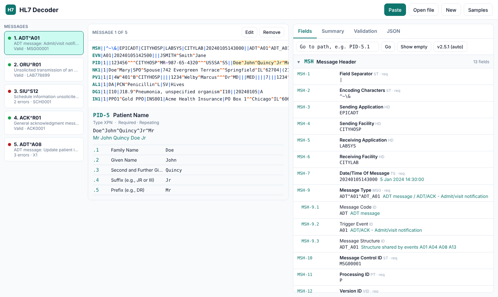
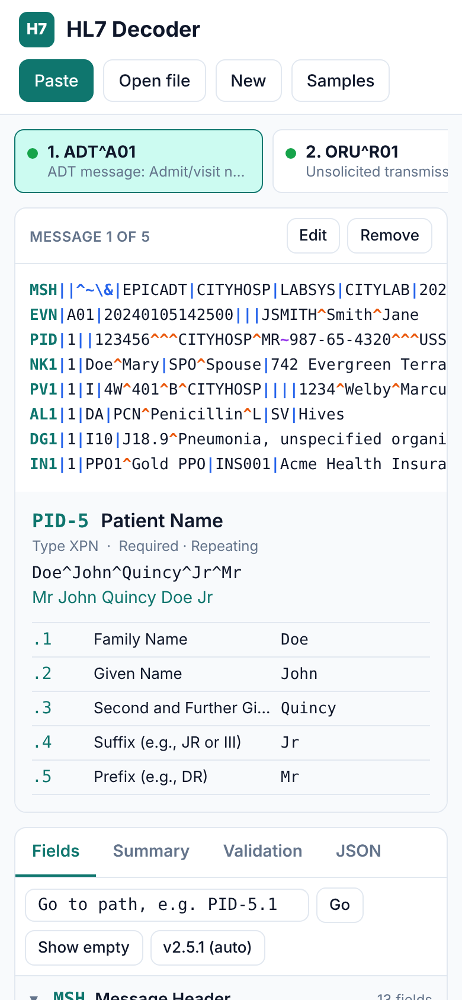
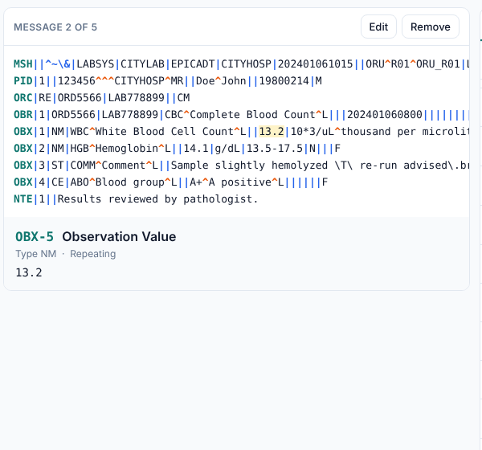
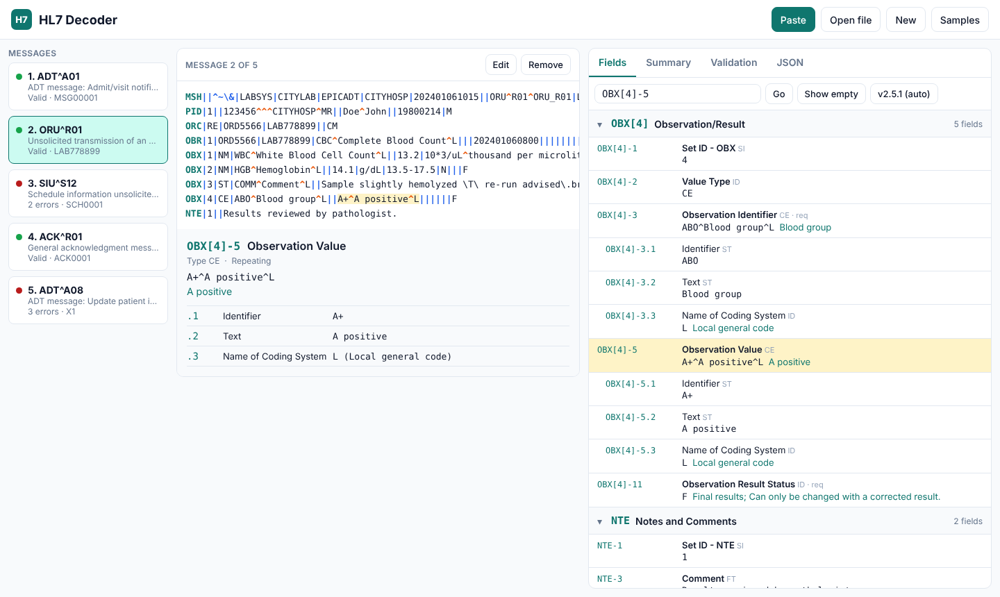
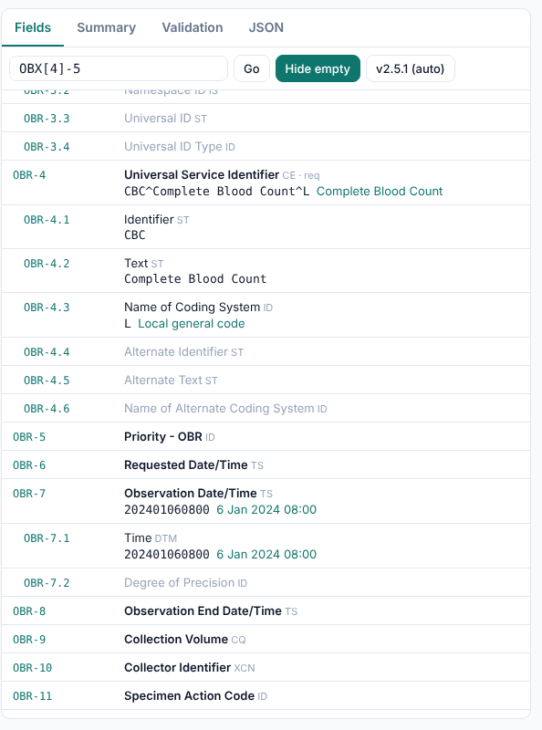
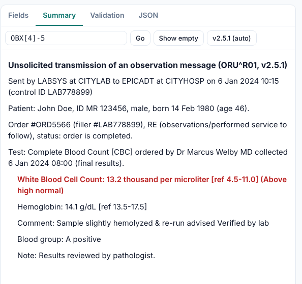
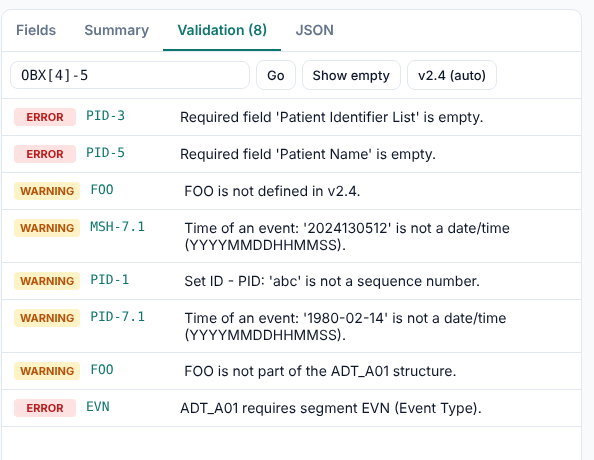
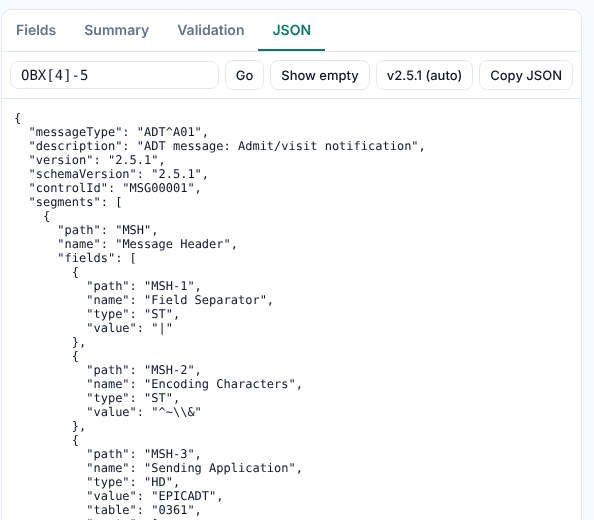
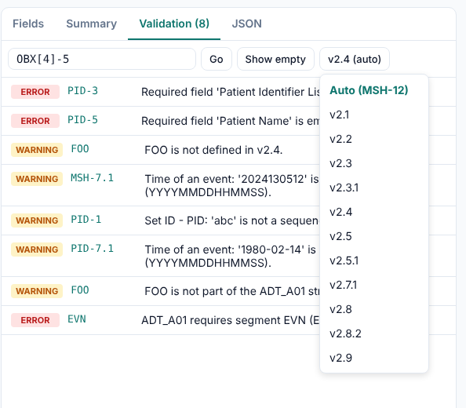
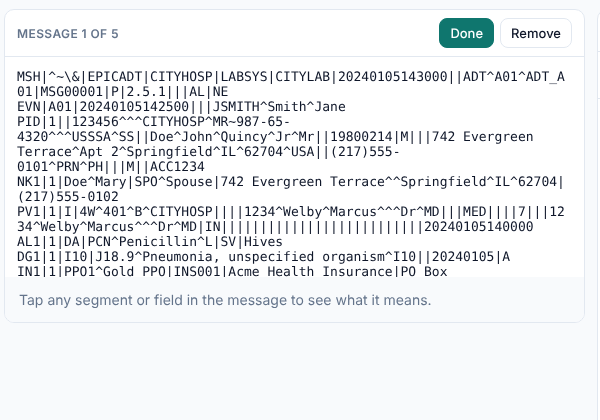

# HL7 Decoder user guide

HL7 Decoder explains HL7 v2 messages. Paste or open a message and it tells you what every part means, whether anything is wrong, and what the message says in plain English. It runs on phones, tablets, in a web browser and as a Mac app.

On a wide screen (tablet, laptop) the app has three columns:

1. **Messages** — every message you have loaded. The dot shows its state: green for valid, amber for warnings, red for errors.
2. **The message** — the text of the open message, coloured by delimiter, with details of whatever you tap underneath.
3. **Tabs** — Fields, Summary, Validation and JSON views of the same message.

On a phone the same pieces stack in one scrolling column, and the message list becomes a row of cards you swipe sideways.

## On a Mac

The Mac app works the same way as the others: click wherever this guide says tap. It opens in a window wide enough for the three-column layout, and narrowing the window below 900 points switches to the stacked layout.

- **Paste** reads text you copied in any Mac app.
- **Open file** shows the standard macOS Open panel. Hold ⌘ to pick several files. The app can only read files you choose there.
- **Copy JSON** puts the JSON on the Mac clipboard, ready to paste into another app.
- **Help › HL7 Decoder Help** (⌘?) opens this guide in its own window.

To install the Mac app, build it from the source as described in [macos.md](macos.md).

## Getting messages in

| Button | What it does |
| --- | --- |
| **Paste** | Reads the clipboard and adds every message in it. |
| **Open file** | Pick one or more files (`.hl7`, `.txt`, anything plain text). Every message in them is added. |
| **New** | Adds a blank message skeleton and opens it for editing. |
| **Samples** | Replaces the list with five example messages: an admission, lab results, an appointment, an error acknowledgement and a deliberately broken message. |

Files and pastes can hold many messages. A new message starts at each `MSH` line, batch wrappers (`FHS`, `BHS`, `BTS`, `FTS`) are skipped, and MLLP framing characters are ignored. Lines can end in CR, LF or CRLF. If nothing that looks like HL7 is found, a notice says so and nothing is added.

The app does not send messages anywhere. Everything is decoded on your device.

## Reading a message

The message is shown as written, with the separators coloured so the structure stands out:

| Colour | Character | Separates |
| --- | --- | --- |
| Teal, bold | `MSH`, `PID` … | Segment IDs |
| Blue | `\|` | Fields |
| Orange | `^` | Components |
| Purple | `~` | Repeats of a field |
| Green | `&` | Subcomponents |

(Messages that declare different separators in MSH-2 are coloured by their own characters.)

**Tap any field** to select it. The panel underneath shows:

- its **path** (for example `OBX-5`) and **name** (Observation Value),
- its **datatype**, the **code table** it uses, and whether it is **required** or **repeating**,
- the **value** with escape sequences decoded, so `\T\` shows as `&`,
- its **meaning**: the description of a code, a readable date, or a name or address put together,
- its **components**. Tap one to drill in further.

Tap a segment ID (such as `PID`) to select the whole segment.

Long lines scroll sideways.

### Paths

Every part of a message has a path:

| Path | Means |
| --- | --- |
| `PID` | The PID segment |
| `PID-5` | Field 5 of PID (Patient Name) |
| `PID-5.1` | Component 1 of that field (Family Name) |
| `PID-3[2]` | The second repeat of PID-3 |
| `PID-3[2].4.1` | Subcomponent 1 of component 4 of that repeat |
| `OBX[2]-5` | Field 5 of the second OBX segment |

`MSH.9.2` (dots instead of a dash) and lowercase are accepted too.

To jump to a path, type it in **Go to path** and press Enter or **Go**. The field is selected, highlighted in the message, and scrolled into view in the Fields tab. If the message has nothing at that path, a notice says so.

## The tabs

### Fields

Every segment as a table: path, name, datatype (with `req` for required fields), value, and meaning in teal. Components and subcomponents are indented under their field, and repeats are listed as `#1`, `#2` and so on. Tap a segment header to collapse or expand it, and tap a row to select it.

**Show empty** also lists the fields and components the HL7 definition expects but the message leaves blank, in grey. This helps when you are working out where a value should go. **Hide empty** turns it off.

### Summary

The message in plain English: who sent it and when, the patient, the visit, orders and tests, each result with its units and reference range, allergies, diagnoses, procedures, appointments, insurance, and the outcome of an acknowledgement.

Abnormal results and errors are shown in red. Tap a line to select the segment it came from.

### Validation

Problems found in the message, most serious first:

| Level | Examples |
| --- | --- |
| **Error** | The message doesn't start with MSH. A required field is empty (PID-3 Patient Identifier List). A segment the message type requires is missing (an ADT^A01 needs EVN). |
| **Warning** | A segment the version doesn't define, or that doesn't belong in this message type. A date, time or number that isn't in HL7 format. A field that repeats but shouldn't. Data past the last defined field. |
| **Info** | A code that isn't in the HL7 table. These tables follow the latest HL7 release, so an older code may still be fine. A version with no bundled definitions, so the nearest one was used. |

Custom Z-segments (`ZXY` …) are never flagged. Tap an issue to select the field it is about.

The tab title shows how many errors and warnings there are, and the message list shows a coloured dot for each message.

### JSON

The decoded message as JSON, with each field's path, name, type, value and meaning. **Copy JSON** puts it on the clipboard.

## HL7 versions

The app has definitions for HL7 v2.1, 2.2, 2.3, 2.3.1, 2.4, 2.5, 2.5.1, 2.7.1, 2.8, 2.8.2 and 2.9. It uses the version in MSH-12. When that version isn't bundled it uses the nearest one, so 2.6 is read as 2.5.1 and 2.7 as 2.7.1. With no MSH-12 it uses 2.5.1.

To read a message as a different version (for example a sender that claims 2.3 but sends 2.5 fields), open the version menu next to **Show empty** and pick one. **Auto (MSH-12)** goes back to the message's own version. The choice applies to every message in the list.

## Editing

Tap **Edit** above the message to change its text. Everything (the list dot, fields, summary and validation) updates as you type. Tap **Done** to go back to the coloured view. **Remove** deletes the open message from the list. It doesn't touch any file you opened.

## Tips

- If a value looks wrong, check the Validation tab first. A missing or extra `|` earlier in the line shifts every field after it.
- An empty field and `""` are different. `""` means "delete the stored value", and the app shows it as *Explicit null*.
- `OBX-5` takes its datatype from `OBX-2`, so a coded result (`CWE`) shows the code's text, and a numeric one (`NM`) is checked for being a number.
